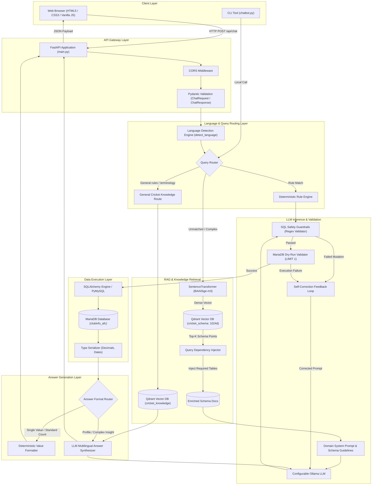
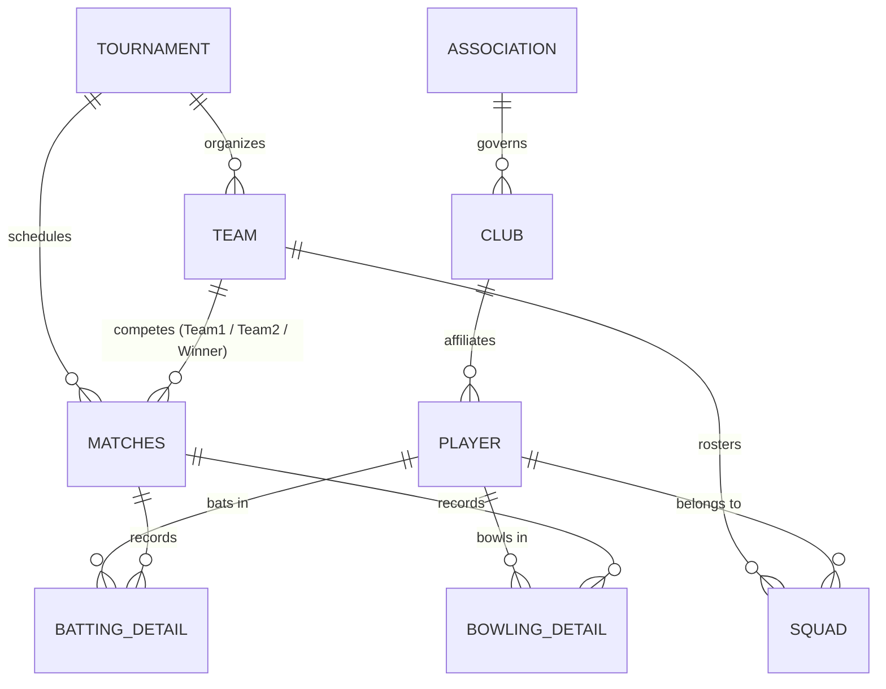

# 🏛️ System Architecture: AI-Powered Multilingual Cricket Assistant

This document outlines the architectural blueprint, design principles, component interactions, and data flows of the **AI-Powered Multilingual Cricket Assistant**.

---

## 1. Executive Summary

The Cricket Assistant is a specialized **Natural Language to SQL (NL2SQL)** platform enhanced with **Retrieval-Augmented Generation (RAG)**. It is purpose-built to query a rich relational database of cricket information (`clubinfo_afc`) consisting of over 70 tables, supporting complex aggregations, multi-table joins, and statistical calculations across both **English** and **Roman Urdu**.

The active API combines deterministic speed with generative intelligence:
- Common, formulaic queries execute via **high-speed deterministic pattern matching** in sub-milliseconds.
- Open-ended, conversational, and complex ad-hoc queries route to a **schema RAG pipeline** backed by dense schema embeddings, dependency injection, and a configurable Ollama model.
- General cricket rules and terminology route to a **separate knowledge RAG pipeline** with passage-level retrieval, relevance filtering, source metadata, and grounded answer generation.

---

## 2. High-Level Architecture Diagram

---

## 3. Core Architectural Layers

### 3.1 Client Layer
- **Web Frontend**: A zero-dependency single-page application consisting of `index.html`, `styles.css`, and `app.js`.
- **User Experience**: Features real-time backend connection status checking, prompt suggestion chips, conversation history clearing, animated loading feedback, collapsible generated SQL inspector, and dynamically generated HTML table views for query results.
- **CLI Shell**: A terminal client (`chatbot.py`) designed for debugging, latency testing, and operator administration.

### 3.2 API & Gateway Layer (`main.py`)
- Built using **FastAPI** running on **Uvicorn**.
- Provides CORS middleware to permit browser-based asynchronous communication from anywhere on the local network.
- Enforces strict input/output contracts using **Pydantic**:
  - `ChatRequest`: Validates user question strings.
  - `ChatResponse`: Standardizes response schemas (language, final natural language answer, generated SQL query, column names, and row data).
- Implements `serialize_cell()` to sanitize non-JSON types (such as `Decimal`, `datetime.date`, and `datetime.datetime`) before transport.

### 3.3 Language Detection & Routing Engine (`answer_generator.py`)
- Analyzes incoming strings for vocabulary markers, grammars, and syntax patterns.
- Distinguishes between **English** and **Roman Urdu** using:
  - Strong Roman Urdu tokens: `kon`, `kaun`, `kitni`, `kitne`, `khiladi`, `banaye`, `sabse`, `zyada`, `teamen`, `batao`, `kisne`, etc.
  - Structural tokens: `hai`, `hain`, `kya`, `ka`, `ki`, `ke`, `mein`, `se`, `ko`.
  - Prominent English patterns: `how many`, `what is`, `who scored`, `which player`, `registered players`.
- Preserves context so responses honor the speaker's language without falling back to unintended scripts.

### 3.4 Dual-Path Query Routing Engine (`sql_generator.py`)
Queries pass through a two-tier evaluation mechanism:

1. **Deterministic Fast Path**:
   - Executes prioritized regular expression matchers for predictable queries:
     - Entity counts (`matches`, `seasons`, `cities`, `countries`, `grounds`, `teams`, `clubs`, `registered players`).
     - Player profiles (batting style, bowling style, playing role, country, city).
     - Match win statistics for specific teams or all-time winners.
     - Single-innings boundaries, centuries, fifties, and all-time highest scores.
   - Bypasses LLM generation to guarantee **0ms generation overhead**, zero hallucination risk, and 100% syntactic correctness.

2. **Semantic RAG Path**:
   - For all conversational, multi-predicate, or unmapped queries, the query is handed off to the RAG retriever.

### 3.5 RAG Schema Retrieval & Dependency Injector (`rag/retriever.py`)
- **Dense Vector Embedding**: Uses the state-of-the-art multilingual model `BAAI/bge-m3` producing 1024-dimensional dense vectors.
- **Vector Database**: Connects to **Qdrant** running locally, querying the `cricket_schema` collection using cosine distance similarity.
- **Automated Schema Dependency Injection**:
  - Pure semantic search often fails when users ask questions that implicitly span multiple tables (e.g. asking *"How many matches has Rawal Kings won?"* may retrieve `matches` schema but miss the `team` schema needed for joining).
  - The dependency engine inspects intent and injects required relational pairs:
    - Wins/Matches $\rightarrow$ Injects `matches.txt` and `team.txt`.
    - Runs/Scores $\rightarrow$ Injects `batting_detail.txt` and `player.txt`.
    - Wickets/Bowling $\rightarrow$ Injects `bowling_detail.txt` and `player.txt`.
    - Tournaments $\rightarrow$ Injects `tournament.txt` and `team.txt`.
    - Standings $\rightarrow$ Injects `point_table.txt`.

### 3.6 LLM Inference & Self-Healing Validation Loop (`sql_generator.py`)
1. **Prompt Construction**: Merges `SYSTEM_PROMPT`, retrieved schema definitions, relational constraints, and user question into an instruction payload.
2. **Inference**: Invokes the model configured by `OLLAMA_MODEL` with temperature `0` via Ollama.
3. **Output Cleaning**: Strips markdown code blocks, backticks, comments, and extra text.
4. **Safety & Table Verification**:
   - Enforces read-only semantics (`SELECT` and `WITH` only).
   - Blocks data modification keywords (`INSERT`, `UPDATE`, `DELETE`, `DROP`, `ALTER`, `TRUNCATE`, `GRANT`, `REVOKE`).
   - Verifies all referenced tables exist within the database's 70+ table whitelist.
5. **Dry-Run MariaDB Validation**:
   - Appends `LIMIT 1` and attempts to execute the query against the live database.
   - If MariaDB returns an error (e.g., misspelled column, invalid join, ambiguous group by), the self-correction engine constructs a corrective prompt displaying the previous SQL and the exact database error.
   - Allows up to 2 automated self-correction attempts before terminating.

### 3.7 Answer Synthesis Engine (`answer_generator.py`)
- **Single-value / Count / Sum queries**: Formatted deterministically using natural templates in English or Roman Urdu, eliminating token latency.
- **Multi-attribute / Complex queries**: The SQL query, column names, and returned rows are supplied to `Qwen 2.5 7B` along with `ANSWER_PROMPT` to synthesize a concise, factual natural language summary strictly in Latin script (English or Roman Urdu).

---

## 4. Domain Data Model Overview

The database `clubinfo_afc` manages complete domestic cricket operations. Key core tables and their logical connections:

### Critical Domain Rules:
1. **Match Winners (`matches`)**:
   - When a match is abandoned, drawn with no result, or recorded with an unmapped team, `Winner` equals `0`.
   - All win calculation queries enforce: `WHERE m.Winner IS NOT NULL AND m.Winner > 0`.
2. **Aggregations over Entity IDs**:
   - Grouping operations must group by primary numeric IDs (`PlayerId`, `TeamId`, `Winner`) rather than free-text names (`BatsmanName`, `BowlerName`) to avoid fragmenting statistics due to spelling variations.
3. **Format Distinctions**:
   - Career aggregate queries reference `batting_stats` and `bowling_stats`.
   - Innings-level statistics (individual highest score, individual match bowling figures, single-innings 50s/100s) reference `batting_detail` and `bowling_detail`.

---

## 5. Security & Reliability Guardrails

| Threat / Failure Mode | Architectural Defense | Implementation |
| :--- | :--- | :--- |
| **SQL Injection / Destructive Queries** | Read-Only Whitelist & Keyword Blocklist | `validate_sql_safety()` rejects multi-statement queries and mutations |
| **Hallucinated Tables / Columns** | Table Whitelisting & Schema Dry-Run | `validate_sql_tables()` + `try_execute_sql(LIMIT 1)` |
| **LLM Output Formatting Drift** | Strict Regex Extraction & Sanitization | `clean_sql_output()` ensures query ends with `;` and strips markdown |
| **Script/Encoding Hallucination** | Unicode Sanitizer | `clean_llm_answer()` strips Arabic/Persian Unicode ranges for Roman Urdu |
| **CORS / Origin Blocking** | Universal Allowed Origins Middleware | FastAPI `CORSMiddleware` configured with `allow_origins=["*"]` |
| **Non-Serializable Cell Types** | Explicit Pre-Serialization | `serialize_cell()` transforms Decimal/Date objects |

## 6. Deployment Configuration and Paths

`backend/settings.py` loads the repository-root `.env` file using a path derived from its own location. Database credentials, database connection details, Ollama model/server, embedding model, Qdrant URL, and collection names are centralized there. Set `DB_USER` and `DB_PASSWORD` in `.env`; credentials are not embedded in application modules. See `README.md` for the environment-variable list and setup steps.

Data-processing scripts resolve schema input/output folders from their own file locations rather than the shell's working directory. The frontend defaults to the API on the same host at port `8000`; `window.CRICKET_API_BASE_URL` can override that value for a different deployment.
