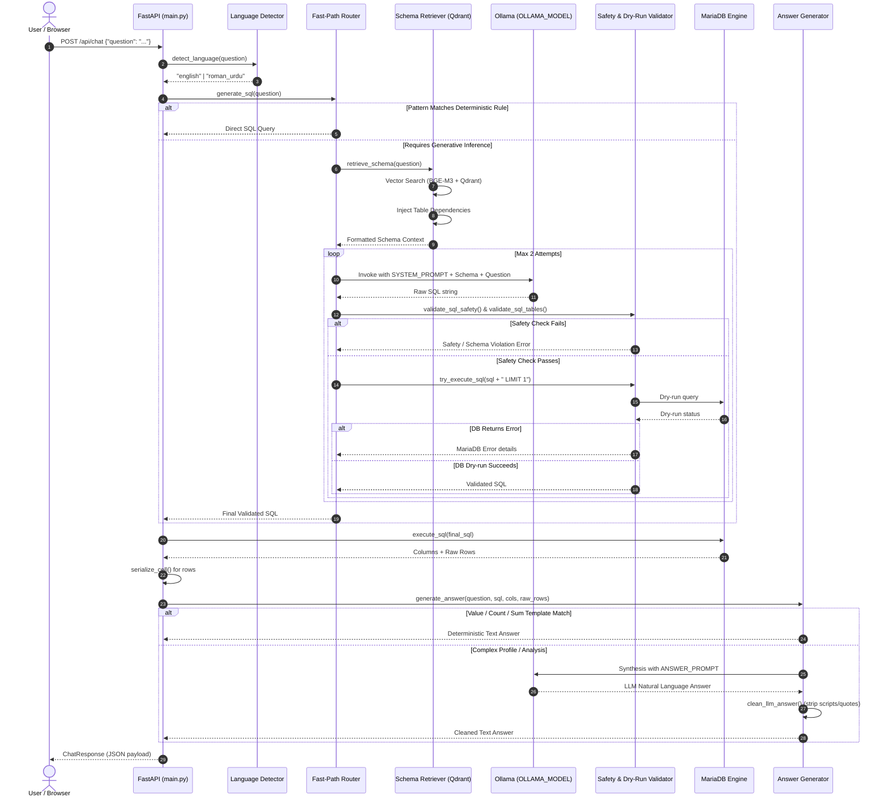

# ⚙️ Backend Pipeline Documentation

This document provides a detailed, technical walkthrough of the backend execution pipeline for the **AI-Powered Multilingual Cricket Assistant**. It describes each phase of query lifecycle execution from raw user input to final response delivery.

---

## 1. Pipeline Execution Flow



---

## 2. Step-by-Step Technical Lifecycle

### Step 1: Request Ingestion & Schema Validation
- **Module**: `backend/main.py`
- **Component**: `@app.post("/api/chat")`
- **Behavior**:
  - Receives incoming JSON payload containing `{ "question": "<string>" }`.
  - Pydantic model `ChatRequest` validates that the query is non-empty and well-formed.
  - Strips leading and trailing whitespace. If empty, raises an HTTP 400 Bad Request exception.

### Step 2: Language Identification
- **Module**: `backend/answer_generator.py`
- **Function**: `detect_language(text: str) -> str`
- **Behavior**:
  - Evaluates query against regex dictionaries:
    - **English Indicators**: Checks for standard phrases (`how many`, `what is`, `who scored`, `start date`, etc.).
    - **Strong Roman Urdu Tokens**: Words unique to Roman Urdu (`kon`, `kaun`, `kitni`, `khiladi`, `banaye`, `sabse`, `zyada`, `teamen`, `kisne`).
    - **Structural Roman Urdu Tokens**: Grammatical markers (`hai`, `hain`, `kya`, `ka`, `ki`, `ke`, `mein`, `se`, `ko`).
  - Returns either `"english"` or `"roman_urdu"`.

### Step 3: Fast-Path Rule Evaluation
- **Module**: `backend/sql_generator.py`
- **Function**: `generate_sql(question: str) -> str`
- **Behavior**:
  - Tests user query against an array of deterministic rule matchers:
    - `generate_direct_database_counts_sql`: Handles count queries for matches, grounds, seasons, teams, cities, countries, associations, and clubs.
    - `generate_direct_team_info_sql`: Handles team IDs, short names, tournament start dates, and specific club win counts.
    - `generate_direct_sixes_fours_sql`: Handles boundary totals and top boundary scorers.
    - `generate_direct_centuries_fifties_sql`: Handles player centuries, fifties, double centuries, and highest innings totals.
    - `generate_direct_player_profile_sql`: Handles player batting styles, bowling styles, roles, cities, and countries.
    - `generate_direct_player_stat_sql`: Resolves individual player aggregate runs, fours, and sixes.
    - `generate_direct_rankings_bowling_sql`: Handles top wicket-takers, 5-wicket hauls, and best innings figures.
    - `generate_direct_most_runs_sql`: Handles questions regarding the all-time top run scorer.
  - **Resolution**: If a rule matches, the pre-compiled, highly optimized SQL is immediately returned, bypassing RAG and LLM processing entirely.

### Step 4: Semantic Schema Retrieval & Dependency Injection
- **Module**: `backend/rag/retriever.py`
- **Function**: `retrieve_schema(question: str, top_k: int = 5) -> str`
- **Behavior**:
  1. **Vector Search**: Converts the question into an embedding using `SentenceTransformer("BAAI/bge-m3")` and queries Qdrant collection `cricket_schema` (cosine similarity, limit = `top_k`).
  2. **Dependency Detection**: Runs `detect_query_dependencies(question)` to identify essential relational pairs required for relational joins:
     - Match victory queries $\rightarrow$ `matches.txt` + `team.txt`
     - Batting queries $\rightarrow$ `batting_detail.txt` + `player.txt`
     - Bowling queries $\rightarrow$ `bowling_detail.txt` + `player.txt`
     - Tournament queries $\rightarrow$ `tournament.txt` + `team.txt`
     - Standings queries $\rightarrow$ `point_table.txt`
  3. **Schema Consolidation**: Appends missing dependency points to the retrieved vector results, prioritizes exact table name matches, and compiles the consolidated schema string.

### Step 5: Generative SQL Inference
- **Module**: `backend/sql_generator.py`
- **Behavior**:
  - Compiles an instruction prompt containing:
    - `SYSTEM_PROMPT`: Instructions for table relationships, mandatory `Winner > 0` filtering, tie handling, and case sensitivity.
    - `DATABASE SCHEMA`: The retrieved schema context from Step 4.
    - `QUESTION`: The raw user query.
  - Calls `OllamaLLM(model=OLLAMA_MODEL, temperature=0)`, where `OLLAMA_MODEL` is loaded from the project-root `.env`.

### Step 6: SQL Sanitization & Guardrails Check
- **Module**: `backend/sql_generator.py`
- **Functions**: `clean_sql_output()`, `normalize_table_names()`, `validate_sql_safety()`, `validate_sql_tables()`
- **Behavior**:
  1. **Clean Output**: Removes markdown formatting (````sql`), extracts statements starting with `SELECT` or `WITH`, and strips chained statements.
  2. **Normalize Names**: Normalizes table casing to match MariaDB's case-sensitive schema.
  3. **Safety Validation**: Strictly blocks mutation operations (`INSERT`, `UPDATE`, `DELETE`, `DROP`, `ALTER`, `TRUNCATE`, `GRANT`, `REVOKE`).
  4. **Table Verification**: Parses all `FROM` and `JOIN` table names and verifies they exist in `KNOWN_TABLES`.

### Step 7: MariaDB Dry-Run & Self-Correction Retry Loop
- **Module**: `backend/sql_generator.py`
- **Function**: `try_execute_sql(sql: str)`
- **Behavior**:
  - Appends `LIMIT 1` to the candidate query and executes it in a transaction test against the live MariaDB engine.
  - **Success**: If query executes without error, candidate SQL is approved.
  - **Failure**: If an exception is raised (e.g., `OperationalError: Unknown column 'xyz' in 'field list'`):
    - Activates `build_retry_prompt()` including the failed SQL and the exact database error message.
    - Sends corrective prompt back to Qwen 2.5 7B.
    - Repeats validation (up to 2 total attempts).

### Step 8: Database Execution & Result Serialization
- **Module**: `backend/main.py`
- **Function**: `execute_sql(sql: str)`
- **Behavior**:
  - Opens connection to MariaDB via SQLAlchemy:
    ```python
    with engine.connect() as conn:
        result = conn.execute(text(sql))
        columns = list(result.keys())
        raw_rows = result.fetchall()
    ```
  - Runs `serialize_cell()` on every data cell to guarantee standard JSON serialization:
    - `Decimal('15427')` $\rightarrow$ `15427` or `"15427"`
    - `datetime.date(2013, 3, 1)` $\rightarrow$ `"2013-03-01"`
    - `datetime.datetime(...)` $\rightarrow$ `"2013-03-01 00:00:00"`

### Step 9: Natural Language Answer Synthesis
- **Module**: `backend/answer_generator.py`
- **Function**: `generate_answer(question, sql, columns, rows) -> str`
- **Behavior**:
  - Checks if result set is empty:
    - English: *"No matching records were found."*
    - Roman Urdu: *"Koi matching data ya record nahi mila."*
  - **Deterministic Value Formatting**:
    - Single-column attributes (batting styles, playing roles, start dates, short names) format instantly via pre-defined templates in the target language.
    - Single-column counts and sums format with comma-separated numbers (e.g., *"Database mein total 301 grounds hain."*).
  - **LLM Synthesis**:
    - For multi-column player profiles, tournament rankings, or complex statistical results, formats `ANSWER_PROMPT` with columns and up to 20 rows.
    - Invokes the configured `OLLAMA_MODEL` with temperature `0`.
    - Filters response using `clean_llm_answer()` to strip quotes, code fences, and any unintended Perso-Arabic unicode characters, enforcing pure Latin script.

### Step 10: JSON Response Packaging
- Returns `ChatResponse`:
  ```json
  {
    "question": "Who scored the most runs?",
    "language": "english",
    "answer": "Aman Arshad scored the most runs with a total of 15,427 runs.",
    "sql": "SELECT bd.PlayerId, COALESCE(p.FullName, MAX(bd.BatsmanName)) AS PlayerName, SUM(bd.Runs) AS TotalRuns FROM batting_detail bd LEFT JOIN player p ON bd.PlayerId = p.PlayerId WHERE bd.PlayerId IS NOT NULL GROUP BY bd.PlayerId, p.FullName ORDER BY TotalRuns DESC LIMIT 1;",
    "columns": ["PlayerId", "PlayerName", "TotalRuns"],
    "rows": [[238, "Aman Arshad", 15427]]
  }
  ```
- The frontend renders the answer bubble, an expandable SQL query container, and an interactive data table.

---

## 3. Error Handling & Resilience Matrix

| Pipeline Stage | Potential Failure | Handling & Recovery |
| :--- | :--- | :--- |
| **API Entry** | Empty or blank string | HTTP 400 Bad Request returned with descriptive error |
| **Routing** | Unmatched pattern | Graceful fallback to Semantic RAG + LLM path |
| **Qdrant Retrieval** | Qdrant offline or missing point | Warns and continues with static system schema |
| **LLM Generation** | Markdown or conversational chatter | `clean_sql_output()` regex isolates pure SQL statement |
| **Safety Check** | Detected `INSERT` / `DROP` / `DELETE` | Fails safety check and invokes self-correction prompt |
| **MariaDB Dry-Run** | Syntax / Column error | Error returned to LLM for automated retry |
| **Answer Synthesis** | Empty LLM output / truncation | Fallback to deterministic summary extracted directly from row data |
| **Database Connection** | MariaDB unreachable | API catches exception, logs traceback, returns HTTP 500 |

## 4. Runtime Configuration and Portable Paths

`backend/settings.py` loads `.env` from the repository root regardless of the process working directory. Set database credentials in `.env`; select the Ollama chat model with `OLLAMA_MODEL`, embedding model with `EMBEDDING_MODEL`, and service endpoints with `OLLAMA_BASE_URL` and `QDRANT_URL`. The schema and retained knowledge RAG collections are configured separately as `SCHEMA_COLLECTION` and `KNOWLEDGE_COLLECTION`.

Schema extraction, enrichment, chunking, and indexing resolve their input/output paths from their own source-file locations. No project source path needs to be edited after relocating the checkout. The frontend infers the API host from the browser host and defaults to port `8000`; a `?api=<encoded-api-url>` query parameter can override it.
