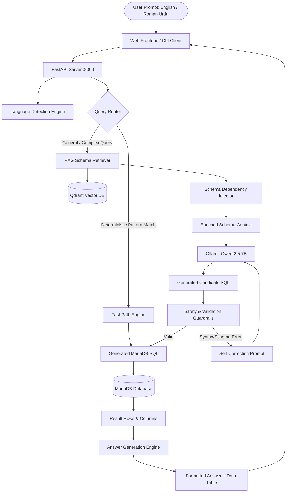

# 🏏 AI-Powered Multilingual Cricket Assistant

An advanced, production-grade **Text-to-SQL and Retrieval-Augmented Generation (RAG)** analytics system engineered to answer complex statistical questions about cricket tournaments, teams, players, and match records in both **English** and **Roman Urdu**.

The system translates natural language queries into executable MariaDB/MySQL SQL statements, runs them safely against a comprehensive relational database (`clubinfo_afc`), and returns both structured table data and human-like natural language explanations.

---

## 🌟 Key Features

- **🌐 Multilingual Query Processing**:
  - Native support for both **English** (e.g., *"Who scored the most runs?"*) and **Roman Urdu** (e.g., *"Sab se zyada runs kis khiladi ne banaye?"*).
  - Robust language detection engine classifying queries into English or Roman Urdu and delivering answers strictly in the queried language (Latin script).
- **⚡ Dual-Path Hybrid Architecture**:
  - **Deterministic Fast Path**: High-speed regex rule engine for instant sub-millisecond retrieval of common queries (counts, player profiles, batting styles, team lookups).
  - **Semantic RAG Path**: Vector-based semantic search powered by `BAAI/bge-m3` embeddings and a Qdrant vector database for complex, ad-hoc, and multi-table queries.
- **🧠 Schema Dependency Injection**:
  - Automatically identifies query intent and injects mandatory join tables (e.g., linking `matches` with `team` for win queries, or `batting_detail` with `player` for batting stats) to prevent incomplete context.
- **🔒 Enterprise SQL Safety & Self-Healing Loop**:
  - Enforces read-only operations (`SELECT` / `WITH`); strictly blocks data-modifying statements (`INSERT`, `UPDATE`, `DELETE`, `DROP`, `ALTER`, `TRUNCATE`).
  - Table name validation against known schema definitions.
  - Dry-run validation against MariaDB with automatic LLM self-correction retry on syntax or schema errors.
- **📊 Interactive Web UI**:
  - Modern, responsive chat interface built with clean HTML5, CSS3, and JavaScript.
  - Live API status badge, example prompt chips, auto-resizing text input, collapsible SQL query viewer, and dynamic tabular result rendering.
- **🤖 Local LLM Powered**:
  - Powered by `Qwen 2.5 (7B)` running locally via **Ollama**, ensuring complete data privacy and zero API cost.

---

## 🏗️ System Architecture



---

## 📂 Repository Structure

```plaintext
├── backend/
│   ├── main.py                     # FastAPI application entry point with /api/chat
│   ├── sql_generator.py            # Hybrid SQL generator (Fast path + RAG + LLM retry loop)
│   ├── answer_generator.py         # Natural language answer generator & language detector
│   ├── chatbot.py                  # Interactive CLI chatbot
│   ├── agent.py                    # Standalone single-table SQL agent
│   ├── graph_agent.py              # LangGraph state-graph implementation
│   ├── graph_chatbot.py            # LangGraph chatbot workflow
│   ├── database.py                 # Direct MariaDB connection testing utility
│   ├── database/
│   │   ├── __init__.py
│   │   └── db.py                   # SQLAlchemy engine & LangChain SQLDatabase connector
│   ├── prompts/
│   │   ├── system_prompt.py        # System prompt with SQL generation rules & relationships
│   │   └── answer_prompt.py        # Natural language synthesis prompt (English / Roman Urdu)
│   ├── rag/
│   │   ├── retriever.py            # Semantic search with Qdrant + dependency injection
│   │   ├── store_embeddings.py     # Script to embed and upload schema chunks to Qdrant
│   │   ├── enrich_schema.py        # Heuristic relationship enrichment for schema definitions
│   │   ├── schema_extractor.py     # Automated table schema extraction from MariaDB
│   │   ├── chunk_schema.py         # Schema chunking utility
│   │   ├── knowledge/              # Cricket domain rules & format documentation
│   │   ├── schema_docs/            # Extracted schema text files
│   │   └── schema_docs_enriched/   # Enriched schema with foreign-key relationships
│   ├── utils/
│   │   └── schema_reader.py        # Database schema inspection tool
│   └── accuracy_test.py            # Benchmark accuracy test suite
├── database/
│   └── clubinfo_afc-04-05-26.sql   # Complete MariaDB database dump
├── frontend/
│   ├── index.html                  # Responsive chat interface
│   ├── styles.css                  # UI styling, dark/light accents, badges, tables
│   └── app.js                      # Frontend logic, API communication, markdown & table rendering
├── ARCHITECTURE.md                 # Detailed architecture and design documentation
├── BACKEND_PIPELINE.md             # In-depth walkthrough of the backend execution pipeline
├── requirements.txt                # Curated Python dependencies
└── README.md                       # Main project documentation
```

---

## 🛠️ Technology Stack

| Component | Technology | Purpose |
| :--- | :--- | :--- |
| **Backend Framework** | [FastAPI](https://fastapi.tiangolo.com/) | RESTful API server with auto-docs and CORS support |
| **ASGI Server** | [Uvicorn](https://www.uvicorn.org/) | High-performance asynchronous web server |
| **Relational Database** | [MariaDB](https://mariadb.org/) / MySQL | Stores 70+ tables of cricket tournaments, matches, and players |
| **Database ORM** | [SQLAlchemy](https://www.sqlalchemy.org/) & [PyMySQL](https://pymysql.readthedocs.io/) | Database connections and SQL execution engine |
| **Vector Database** | [Qdrant](https://qdrant.tech/) | Vector storage and similarity search for schema chunks |
| **Embedding Model** | `BAAI/bge-m3` via [Sentence-Transformers](https://sbert.net/) | Multilingual dense embeddings (1024 dimensions) |
| **Large Language Model** | [Qwen 2.5 (7B)](https://huggingface.co/Qwen/Qwen2.5-7B) via [Ollama](https://ollama.ai/) | Text-to-SQL translation & answer generation |
| **LLM Orchestration** | [LangChain](https://www.langchain.com/) & [LangGraph](https://langchain-ai.github.io/langgraph/) | Agent workflows and structured prompt execution |
| **Frontend** | HTML5, CSS3, Vanilla JavaScript | Responsive client interface with tabular results & SQL viewer |

---

## 🚀 Getting Started

### 1. Prerequisites

- **Python**: 3.10 or higher
- **MariaDB** or **MySQL**: Running locally on port `3306`
- **Qdrant**: Running locally on port `6333` (e.g. via Docker)
- **Ollama**: Installed and running locally with the `qwen2.5:7b` model

### 2. Clone the Repository

```bash
git clone <repository-url>
cd "Internsship RAG project"
```

### 3. Create a Virtual Environment & Install Dependencies

```bash
python -m venv venv
# On Windows (PowerShell):
.\venv\Scripts\Activate.ps1
# On Linux / macOS:
source venv/bin/activate

pip install --upgrade pip
pip install -r requirements.txt
```

### 4. Setup Ollama & Download the LLM

Make sure Ollama is running and pull the `qwen2.5:7b` model:

```bash
ollama pull qwen2.5:7b
```

### 5. Setup Qdrant Vector Store

Start Qdrant locally using Docker:

```bash
docker run -d -p 6333:6333 -p 6334:6334 \
    -v $(pwd)/qdrant_storage:/qdrant/storage:z \
    qdrant/qdrant
```

Index the schema chunks into Qdrant:

```bash
cd backend/rag
python store_embeddings.py
cd ../..
```

### 6. Database Setup

1. Start your local MariaDB/MySQL service.
2. Create the user and database as configured in `backend/database/db.py`:
   ```sql
   CREATE DATABASE clubinfo_afc;
   CREATE USER 'appuser'@'127.0.0.1' IDENTIFIED BY 'app123';
   GRANT ALL PRIVILEGES ON clubinfo_afc.* TO 'appuser'@'127.0.0.1';
   FLUSH PRIVILEGES;
   ```
3. Import the database dump:
   ```bash
   mysql -u appuser -p clubinfo_afc < database/clubinfo_afc-04-05-26.sql
   ```

---

## 🏃 Running the Application

### Start the Backend API Server

From the `backend` directory:

```bash
cd backend
python -m uvicorn main:app --host 0.0.0.0 --port 8000 --reload
```

The server will be available at `http://localhost:8000`. You can test the health endpoint at `http://localhost:8000/` or view interactive Swagger docs at `http://localhost:8000/docs`.

### Start the Frontend Client

Open `frontend/index.html` in any modern web browser or serve it with a lightweight HTTP server:

```bash
cd frontend
python -m http.server 3000
```
Then visit `http://localhost:3000` in your browser.

> **Note**: If running on a local network or server, adjust the `API_BASE_URL` in `frontend/app.js` to point to your backend IP/host.

### CLI Mode (Optional)

You can also query the assistant directly from the command line:

```bash
cd backend
python chatbot.py
```

---

## 🧪 Testing & Evaluation

The system includes multiple automated test suites to verify accuracy against ground-truth database records:

```bash
cd backend

# Run the 11-question standard accuracy benchmark:
python accuracy_test.py

# Run the 30-question unseen end-to-end verification suite:
python run_unseen_30_test.py

# Run the comprehensive test suite:
python overall_accuracy_test.py
```

Benchmark Results:
- **Standard Benchmark**: **100.0% (11/11 PASS)**
- **Unseen Test Suite**: Verified across entity counts, player profiles, bowling statistics, and team match wins in English and Roman Urdu.

---

## 🔌 API Reference

### Health Check
- **URL**: `GET /`
- **Response**:
  ```json
  {
    "status": "ok",
    "service": "AI-Powered Multilingual Cricket Assistant"
  }
  ```

### Chat Query
- **URL**: `POST /api/chat`
- **Request Body**:
  ```json
  {
    "question": "Babar Azam ka batting style kya hai?"
  }
  ```
- **Response Body**:
  ```json
  {
    "question": "Babar Azam ka batting style kya hai?",
    "language": "roman_urdu",
    "answer": "Unka batting style Right Hand Batsman hai.",
    "sql": "SELECT BattingStyle FROM player WHERE LOWER(FullName) = LOWER('babar azam') LIMIT 1;",
    "columns": ["BattingStyle"],
    "rows": [["Right Hand Batsman"]]
  }
  ```

---

## 📄 Documentation

For in-depth architectural and implementation details, refer to:
- **[ARCHITECTURE.md](ARCHITECTURE.md)**: System design, vector retrieval model, safety guardrails, and component interaction diagrams.
- **[BACKEND_PIPELINE.md](BACKEND_PIPELINE.md)**: Step-by-step breakdown of the query execution pipeline from request ingestion to answer delivery.

